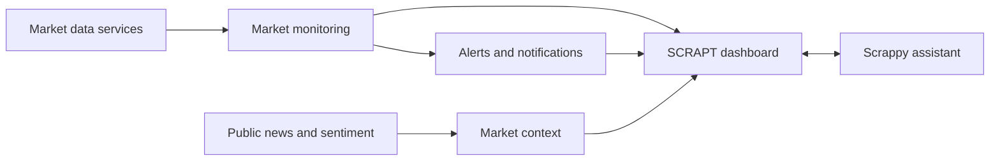

# SCRAPT

**CLARITY IN MARKET CHAOS.**

Real-time market intelligence. Quantitative signals. Data-driven decisions.

SCRAPT brings crypto market monitoring, derivatives indicators, sentiment and alerts into a focused analytical workspace. Its interface helps users read changing conditions and ask Scrappy, the existing assistant, for plain-language explanations of the available market context.

## About this repository

This is the official **public documentation and project presentation** repository for SCRAPT, maintained under **labsscrap-code**.

It contains product documentation, UX/UI direction, a conceptual architecture overview and a roadmap. It does **not** contain the application source, a runnable distribution or installation packages. Cloning this repository does not install SCRAPT.

## What the existing application supports

| Capability | Purpose |
|---|---|
| Market monitoring | Follow crypto prices, recent price history, trade activity and volume. |
| Derivatives context | Read funding rates, Open Interest and trader-positioning indicators. |
| Order-book information | Inspect aggregate buy/sell liquidity and balance. |
| Market sentiment | View sentiment indicators alongside market data. |
| Alerts and watchlists | Review detected events, urgency filters and a multi-asset watchlist. |
| Scrappy assistant | Ask for explanations based on the dashboard's available context. |
| Workspace controls | Use time-range controls, pause/resume and optional sound notifications. |

These describe capabilities of the existing application, not software included in this repository. Data availability depends on connected services. AI explanations depend on a configured, available AI service.

SCRAPT is an information and analysis tool. It does not execute trades, promise returns or provide predictive guarantees.

## Experience principles

- Clear hierarchy and readable financial information.
- A restrained monochromatic identity with semantic market colors.
- Responsive layouts and keyboard-accessible controls.
- Explicit loading, unavailable-data and connection states.
- Explanations grounded in available data rather than invented values.

## Conceptual architecture

This diagram shows product responsibilities and information flow. It does not document backend algorithms, deployment configuration or internal implementation.

## Documentation

- [Documentation index](docs/README.md)
- [Features](docs/features.md)
- [Architecture overview](docs/architecture.md)
- [Roadmap](docs/roadmap.md)
- [Brand and UX direction](docs/brand.md)
- [Project scope and collaboration](docs/project-scope.md)

## Contributing

Documentation, accessibility and UX/UI feedback are welcome. Read the [contribution guide](.github/CONTRIBUTING.md) before opening an issue or pull request.

Do not submit credentials, account data, application source or runtime files. See the [security policy](.github/SECURITY.md) for sensitive reports.

## Availability and licensing

Application downloads and release dates are not announced by this repository. Any future public release will require its own review and documentation.

No software license or application redistribution rights are granted by this documentation publication. No license has been selected for this repository; contact the maintainers before reusing project assets or materials beyond an authorized contribution.
