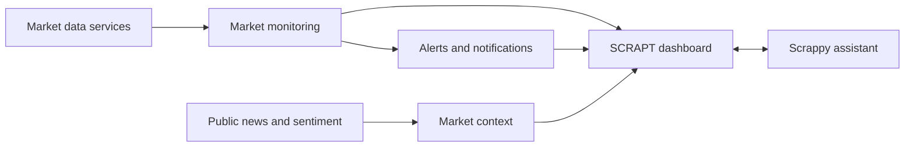

# SCRAPT

**CLARITY IN MARKET CHAOS.**

Real-time market intelligence. Quantitative signals. Data-driven decisions.

SCRAPT brings crypto market monitoring, derivatives indicators, sentiment and alerts into a focused analytical workspace. Its interface helps users read changing conditions and ask Scrappy, the existing assistant, for plain-language explanations of the available market context.

## About this repository

This is the official **public frontend and documentation** repository for SCRAPT, maintained under **labsscrap-code**.

It contains the approved static web interface, a restricted Vercel API proxy and product documentation. The proprietary Python scanner, detection logic, database and core AI orchestration remain on the private backend and are not included.

## Web deployment

Use Node.js 24: `npm ci`, `npm ci --prefix neural-frontier --ignore-scripts --include=dev`, `npm run build`, `npm run lint`, `npm test`.
Vercel serves `public/` and the allowlisted `/api/v1/` function. No frontend framework or runtime dependency is required. The build verifies every approved frontend asset against its SHA-256 manifest. Public Scrappy requires explicit server-side activation and retains upstream quotas.

Configure server-side environment variables `SCRAPT_UPSTREAM_IP`,
`SCRAPT_UPSTREAM_TLS_NAME`, `SCRAPT_UPSTREAM_ORIGIN` and optionally
`SCRAPT_PUBLIC_ORIGIN`. Exact Vercel deployment and production hostnames are also
accepted from Vercel's system environment variables. No credentials belong in this
repository or in frontend configuration.

The proxy verifies the upstream TLS certificate against its configured hostname,
pins the upstream IP to prevent a DNS migration from creating a proxy loop,
validates the actual browser Origin, and preserves secure host-only session cookies,
CSRF tokens and backend rate limits. Authenticated responses are never cached.
The terminal uses anonymous read-only snapshots, history and alerts. Sessions,
news and operator authentication remain protected on the backend; the public
terminal does not request a session or redirect to login. Public Scrappy requires explicit server-side activation and retains upstream quotas.

Before moving the custom-domain DNS, establish a stable backend TLS hostname and
certificate renewal independent of the frontend hostname. Do not retire the
existing VPS services or TLS route while the proxy depends on them.

## What the existing application supports

| Capability | Purpose |
|---|---|
| Market monitoring | Follow crypto prices, recent price history, trade activity and volume. |
| Derivatives context | Read funding rates, Open Interest and trader-positioning indicators. |
| Order-book information | Inspect aggregate buy/sell liquidity and balance. |
| Market sentiment | View sentiment indicators alongside market data. |
| Alerts and watchlists | Review detected events, urgency filters and a multi-asset watchlist. |
| Scrappy assistant | Ask for explanations based on the dashboard's available context. |
| Workspace controls | Use time-range controls, pause/resume and optional sound notifications. |

Data availability depends on connected backend services. Public Scrappy returns English AI interpretations when its configured backend and provider are available; see [frontend release documentation](docs/frontend-release.md) for verified scope and limitations.

SCRAPT is an information and analysis tool. It does not execute trades, promise returns or provide predictive guarantees.

## Experience principles

- Clear hierarchy and readable financial information.
- A restrained monochromatic identity with semantic market colors.
- Responsive layouts and keyboard-accessible controls.
- Explicit loading, unavailable-data and connection states.
- Explanations grounded in available data rather than invented values.

## Conceptual architecture

This diagram shows product responsibilities and information flow. It does not document backend algorithms, deployment configuration or internal implementation.

## Documentation

- [Documentation index](docs/README.md)
- [Features](docs/features.md)
- [Architecture overview](docs/architecture.md)
- [Roadmap](docs/roadmap.md)
- [Brand and UX direction](docs/brand.md)
- [Project scope and collaboration](docs/project-scope.md)

## Contributing

Documentation, accessibility and UX/UI feedback are welcome. Read the [contribution guide](.github/CONTRIBUTING.md) before opening an issue or pull request.

Do not submit credentials, account data, application source or runtime files. See the [security policy](.github/SECURITY.md) for sensitive reports.

## Availability and licensing

Application downloads and release dates are not announced by this repository. Any future public release will require its own review and documentation.

No software license or application redistribution rights are granted by this documentation publication. No license has been selected for this repository; contact the maintainers before reusing project assets or materials beyond an authorized contribution.

## Current frontend source

This branch synchronizes the approved Terminal V3 production frontend. See [routes, build instructions and release boundaries](docs/frontend-release.md). The original landing, Terminal, Neural Frontier, Execution, Micro Replay and Field Notes sources are included. Execution remains locked. Private Python services, production settings and deployment credentials are excluded.
