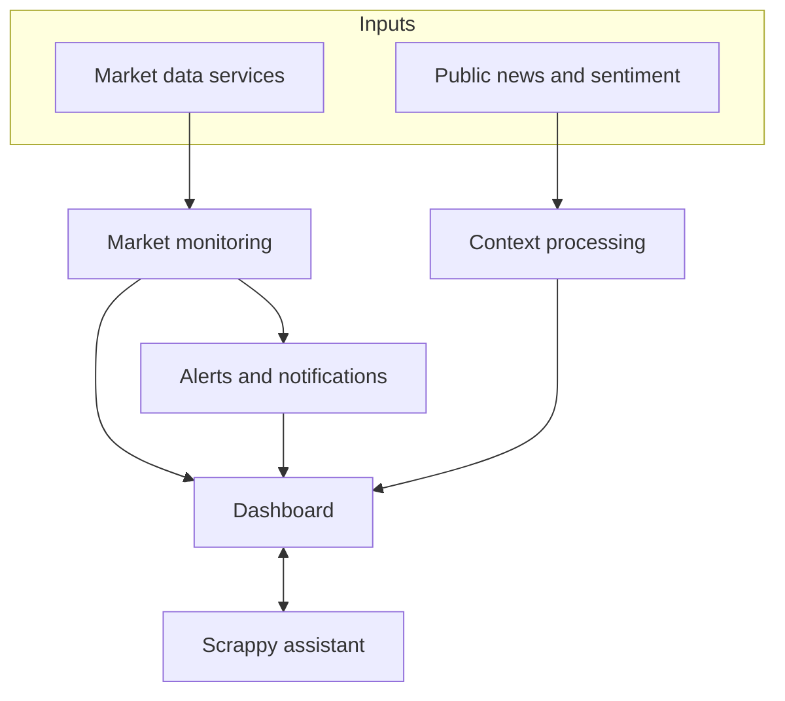

# Architecture overview

SCRAPT combines a market-monitoring application with a dashboard and contextual assistant. This overview is conceptual and deliberately excludes source-level design, algorithms, operational endpoints and deployment details.

## Responsibilities

| Area | Responsibility |
|---|---|
| Market inputs | Supply observed prices, activity, derivatives information and liquidity data. |
| Context inputs | Supply public news and sentiment information. |
| Monitoring | Maintain the application's current view of observed conditions. |
| Alerts | Surface detected events with urgency and explanatory context. |
| Dashboard | Present available information and user controls. |
| Scrappy | Explain available context through the existing AI integration. |

## Information flow

The dashboard presents the information delivered by the running application. Scrappy uses available context to answer questions; it is not a replacement for the data sources or monitoring functions.

## Reliability principles

- Treat missing information as unavailable, rather than as a zero value.
- Separate interface connectivity from upstream data availability.
- Make freshness and connection states understandable.
- Preserve existing monitoring and alert behavior during UX/UI changes.
- Validate real integrations independently from visual presentation.

## Public documentation boundary

This repository contains no application runtime, backend algorithms, configuration values, credentials or operational state. Architectural changes to the application require coordination with the engineer responsible for its core functionality.
